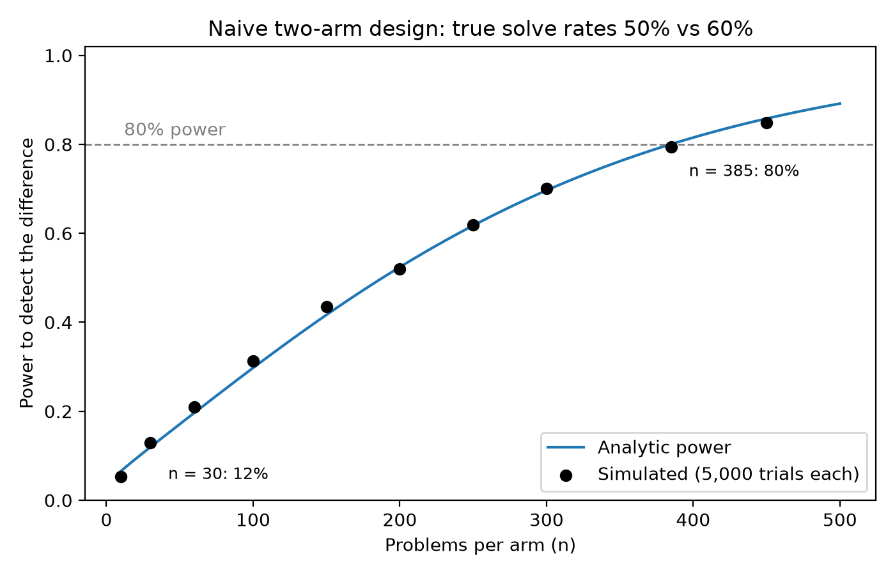
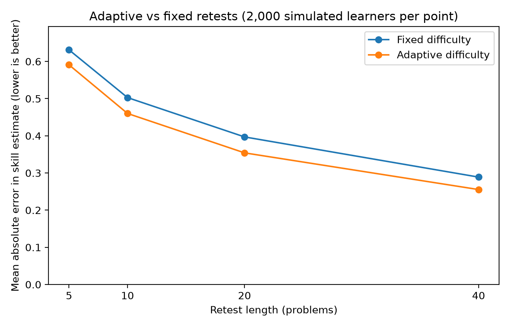

# N-of-1 AI Learning: Adaptive Experimentation for One Learner

A simulation study of how a single learner can find out whether AI helps them learn, using as few practice problems as possible.

> **Status: simulation phase.** No human data has been collected. Everything below comes from simulated learners. Any data from my own competition-math practice would come only after the required approval.

# Research question

For one learner, does AI assistance build durable problem-solving skill, does the way the AI is used (attempt first, AI first, or no AI) change the result, and how few problems are enough to know?

Standard experiments need many participants. A single learner has only their own limited practice time, so the question is whether smarter measurement can replace sheer volume. The idea tested here is **adaptive, difficulty-calibrated retests**: each retest problem is chosen to be near the learner's current skill, which should make every problem more informative.

# What is built so far

1. **Simulated learner** (`src/simulate.py`): latent skill that grows with practice, forgets over time, and responds to each AI-usage protocol with carryover.
2. **Power analysis** of the naive two-arm design.
3. **Skill estimator** (`src/estimate.py`): a Rasch model fit by maximum likelihood on a grid, with an optional weak prior.
4. **Adaptive retest rule** (`src/adaptive.py`): give the unused problem whose difficulty is closest to the current skill estimate.
5. **Comparison** (`src/compare.py`): adaptive vs fixed-difficulty retests at several lengths.
6. **Plots** (`src/plots.py`) and **sanity checks** (`src/sanity.py`).

##Results





I built a simulated learner (skill that grows with practice, forgets, and responds to different AI-usage protocols with carryover), a Rasch skill estimator, and an adaptive retest that picks each problem closest to the current skill estimate. In the naive two-arm design, detecting a true solve-rate difference of 0.50 vs 0.60 needs about 385 problems per arm for 80% power, and with 30 problems per arm power is only about 12%. When estimating a learner's skill from a retest, the adaptive design had lower mean error than a fixed-difficulty design at every length I tested (5, 10, 20, and 40 problems), by about 6 to 12%. These results assume the Rasch model is true and every problem's difficulty is known exactly, so real data will be noisier. Next, I will test how sensitive these results are to forgetting, carryover, and effect size, then work out how many problems each design needs for 80% power.

Mean absolute error in the skill estimate (lower is better), 2,000 simulated learners per row:

| Retest length | Fixed | Adaptive | Adaptive's improvement |
|---------------|-------|----------|------------------------|
|       5       | 0.631 |   0.591  |           6%           |
|       10      | 0.503 |   0.460  |           9%           |
|       20      | 0.397 |   0.354  |           11%          |
|       40      | 0.289 |   0.255  |           12%          |

# Methods

**Skill model.** The probability that a learner with skill θ solves a problem of difficulty b is

`P(solve) = 1 / (1 + exp(-(θ - b)))`

**Estimator.** For a set of right and wrong answers, θ is the value on a grid from -4 to 4 (step 0.02) that makes the answers most likely. Both retest designs add a weak Normal(0, 1.5²) prior, because with pure maximum likelihood a single right or wrong answer sends the estimate to the edge of the grid, and the adaptive rule would then chase a bad estimate.

**Retest designs.** Fixed: problem difficulties are drawn at random from the pool. Adaptive: after each answer, re-estimate θ and give the unused problem whose difficulty is closest to it. Both use the same estimator, so the comparison is fair.

**Comparison setup.** A pool of 200 problems with difficulties from N(0, 1), learners with true skill from N(0, 1), the same learner tested under both designs, retest lengths of 5, 10, 20, and 40, 2,000 simulated learners per length, seed 2026. The metric is the mean absolute difference between estimated and true skill.

**Power analysis.** Two arms with true solve rates 0.50 and 0.60, binary outcomes, two-sided two-proportion z-test at the 5% level. The analytic result is n per arm = (1.96 + 0.84)² × (0.25 + 0.24) / 0.10², about 385. Monte Carlo agrees: 5,000 trials per point.

# Reproduce it

```
pip install numpy scipy matplotlib
cd src
python estimate.py        # estimator demo
python adaptive.py        # adaptive vs random, quick check
python sanity.py          # sanity checks (all should pass)
python compare.py 2000    # writes results/comparison.csv
python plots.py           # writes the two plots in results/
```

# Repository layout

|             Path            |                               Purpose                               |
|-----------------------------|---------------------------------------------------------------------|
|      `src/simulate.py`      | Simulated learner (growth, forgetting, protocol effects, carryover) |
|      `src/estimate.py`      |                        Rasch skill estimator                        |
|      `src/adaptive.py`      |                   Adaptive and fixed retest rules                   |
|       `src/sanity.py`       |          Sanity checks for the estimator and adaptive rule          |
|       `src/compare.py`      |                    Adaptive vs fixed comparison                     |
|        `src/plots.py`       |                Power curve and error-vs-length plots                |
|          `results/`         |                       Output tables and plots                       |
| `docs/problem_statement.md` |                        Full problem statement                       |
|      `LAB_NOTEBOOK.md`      |           Dated notebook of what I did and what I learned           |

# Limitations

- Everything here is simulation. The conclusions hold only as far as the simulated learner resembles a real one.
- The estimator assumes the Rasch model is true and that each problem's difficulty is known exactly. Real difficulties must be estimated.
- The results use one set of simulator settings. The sensitivity analysis is meant to show how much they depend on those settings.
- The error plot shows means only, with no confidence intervals yet.

# Roadmap

- [x] Simulated learner
- [x] Reproduce the naive-design power result (about 385 per arm)
- [x] Rasch estimator
- [x] Adaptive retest rule
- [x] Adaptive vs fixed comparison
- [x] Power and error plots
- [ ] Sensitivity analysis: forgetting rate, carryover fraction, and protocol effect size
- [ ] Problems per arm needed for 80% power under the full simulator, for both designs
- [ ] Confidence intervals on the comparison
- [ ] Pilot on my own competition-math practice, after approval

# Companion tool

A browser tool that uses the same estimator to give AMC/AIME students a skill estimate and a next-problem suggestion: [amc-adaptive](https://github.com/2029Grad/amc-adaptive).

# Author

Pratham Prasanna, Bellarmine College Prep.
